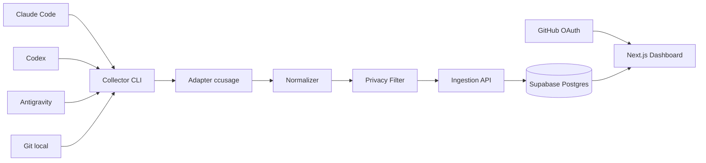

# PRD e Requisitos do Sistema — Tokentômetro MVP

**Status:** pronto para implementação  
**Objetivo de entrega:** MVP funcional e publicado  
**Produto:** telemetria de consumo de tokens para builders que utilizam agentes de programação

---

## 1. Visão do produto

O Tokentômetro é uma plataforma que coleta, normaliza e apresenta métricas de consumo de tokens geradas por agentes de programação usados localmente.

O MVP deve atender builders que utilizam **Claude Code, Codex e Antigravity**, inclusive por meio de assinaturas pessoais, sem exigir chaves de API dos provedores.

O produto terá:

- um coletor local instalado uma vez por máquina;
- uma API segura de ingestão;
- um banco de dados central;
- um dashboard web;
- rankings por builder, agente, modelo e repositório.

O Tokentômetro não deve coletar prompts, respostas, código-fonte, conteúdo de arquivos ou credenciais dos agentes.

## 2. Problema

Builders usam múltiplos agentes, modelos e repositórios, mas não possuem uma visão unificada de:

- quantos tokens consomem;
- quais modelos mais utilizam;
- quais agentes concentram o consumo;
- em quais repositórios o consumo acontece;
- como seu uso se compara ao de outros builders.

As ferramentas atuais apresentam dados isolados por agente e nem sempre associam o consumo ao builder e ao repositório.

## 3. Público-alvo

### Persona principal

Builder individual que:

- utiliza Claude Code, Codex ou Antigravity;
- pode utilizar planos de assinatura em vez de APIs;
- trabalha em um ou mais repositórios Git;
- possui conta no GitHub;
- deseja acompanhar e comparar seu consumo de IA.

### Trabalho a ser realizado

> Quando eu trabalhar com agentes de programação, quero visualizar meu consumo consolidado por modelo, agente e repositório, para entender onde estou usando mais IA e comparar minha atividade com outros builders.

## 4. Objetivos do MVP

1. Permitir autenticação com GitHub.
2. Vincular uma ou mais máquinas ao perfil do builder.
3. Detectar históricos locais compatíveis com Claude Code, Codex e Antigravity.
4. Coletar somente metadados de uso.
5. Associar sessões a repositórios GitHub quando possível.
6. Sincronizar os dados de forma manual, incremental e idempotente.
7. Exibir visão geral e rankings.
8. Dar ao builder controle sobre visibilidade e repositórios compartilhados.
9. Diferenciar claramente tokens consumidos, custo estimado e cobrança real.

## 5. Fora do escopo do MVP

- Chats comuns do ChatGPT, Claude ou Gemini.
- Automações e workflows não relacionados a agentes de programação.
- Sincronização automática em segundo plano.
- Aplicativos nativos para desktop.
- Cobrança ou pagamentos.
- Controle ou bloqueio de orçamento.
- Alteração das configurações dos agentes.
- Leitura de prompts, respostas, código ou arquivos do projeto.
- Cálculo de custo real de assinaturas.
- Garantia de comparação contábil perfeita entre provedores.
- Integrações corporativas e painéis administrativos de organizações.

## 6. Princípios do produto

1. **Privacidade por padrão:** somente metadados necessários.
2. **Consentimento explícito:** nenhuma publicação pública automática.
3. **Somente leitura:** o coletor nunca altera históricos ou projetos.
4. **Transparência:** mostrar uma prévia antes do primeiro envio.
5. **Estimativas identificadas:** custo equivalente nunca deve ser chamado de cobrança real.
6. **Degradação segura:** dados sem associação confiável aparecem como “desconhecido”.
7. **Baixo atrito:** uma configuração por máquina, sem instalação por projeto.

## 7. Fluxo principal de onboarding

1. O builder acessa o dashboard.
2. Seleciona **Entrar com GitHub**.
3. O sistema cria o perfil usando nome, handle e avatar.
4. O builder seleciona **Adicionar computador**.
5. O dashboard gera um código temporário de pareamento.
6. O builder instala ou executa o coletor local.
7. O builder informa o código temporário ao coletor.
8. A API troca o código por uma credencial exclusiva daquele dispositivo.
9. O coletor detecta as fontes locais disponíveis.
10. O coletor mostra:
    - agentes encontrados;
    - período disponível;
    - quantidade de sessões;
    - repositórios identificados;
    - registros sem repositório;
    - campos que serão enviados.
11. O builder escolhe a política para repositórios:
    - permitir todos os públicos;
    - escolher públicos específicos;
    - ocultar privados;
    - anonimizar privados;
    - ignorar repositórios não identificados.
12. O builder confirma a primeira sincronização.
13. O dashboard apresenta os dados importados.
14. Nas sincronizações seguintes, somente dados novos ou atualizados são enviados.

## 8. Requisitos funcionais

### RF-01 — Autenticação

- O dashboard deve permitir login com GitHub.
- Utilizar o menor escopo OAuth possível.
- O MVP não deve solicitar acesso ao conteúdo de repositórios privados.
- O usuário deve conseguir encerrar a sessão.

### RF-02 — Perfil do builder

O sistema deve armazenar:

- identificador interno;
- identificador público do GitHub;
- handle;
- nome de exibição;
- avatar;
- data de criação;
- preferência de visibilidade no ranking.

### RF-03 — Pareamento de dispositivo

- O builder deve conseguir gerar um código temporário no dashboard.
- O código deve expirar em até 10 minutos.
- O código deve ser de uso único.
- Após o pareamento, a API deve fornecer uma credencial exclusiva do dispositivo.
- A credencial deve ser exibida apenas uma vez e armazenada localmente com proteção adequada.
- O builder deve conseguir revogar um dispositivo pelo dashboard.

### RF-04 — Instalação do coletor

Para o MVP, o coletor deve ser distribuído como pacote npm e funcionar como ferramenta global ou por package runner.

Comandos mínimos:

- `tokentometro setup`
- `tokentometro scan`
- `tokentometro sync`
- `tokentometro status`
- `tokentometro logout`

A instalação deve ser por usuário e não deve exigir alterações em cada repositório.

### RF-05 — Detecção de agentes e uso do ccusage

O coletor deve detectar fontes de dados compatíveis com:

- Claude Code;
- Codex;
- Antigravity.

A detecção deve utilizar o **ccusage com versão fixada**, encapsulado por uma camada interna de adaptação.

O MVP não deve copiar a lógica interna do ccusage nem depender diretamente de seu JSON em outras camadas. O adaptador do coletor será responsável por:

1. executar o ccusage localmente;
2. receber a saída estruturada;
3. validar a versão e o formato;
4. converter a saída para o contrato interno do Tokentômetro;
5. impedir que campos não permitidos sejam enviados.

A ausência ou falha de um agente não deve impedir a coleta dos demais.

### RF-06 — Leitura local

- A coleta deve ser somente leitura.
- O coletor deve executar com as permissões do usuário atual.
- Não deve exigir acesso administrativo.
- Não deve ler credenciais dos agentes.
- Não deve enviar arquivos brutos dos históricos.
- Não deve enviar prompts, respostas, comandos, saídas de ferramentas ou código.

### RF-07 — Normalização

Cada registro normalizado deve conter, quando disponível:

- agente de origem;
- modelo;
- data e hora;
- identificador não reversível da sessão;
- tokens de entrada;
- tokens de entrada em cache;
- tokens de criação de cache;
- tokens de saída;
- tokens de raciocínio;
- total de tokens;
- custo equivalente estimado;
- repositório normalizado;
- versão do coletor;
- versão do esquema;
- versão do adaptador ou fonte.

Campos indisponíveis devem ser nulos, nunca inventados.

### RF-08 — Associação a repositório

O coletor deve tentar associar uma sessão a um repositório nesta ordem:

1. referência de projeto ou diretório presente no histórico;
2. descoberta da raiz Git local;
3. leitura do remoto `origin`;
4. primeiro remoto GitHub válido, caso `origin` não exista.

O coletor deve normalizar URLs SSH e HTTPS para o formato `owner/repository`.

Regras:

- nunca enviar o caminho absoluto local;
- repositório público autorizado: enviar `owner/repository`;
- repositório privado oculto: não enviar nome ou URL;
- repositório privado anonimizado: enviar somente hash estável;
- falha de associação: utilizar `unknown`.

### RF-09 — Prévia de coleta

Antes da primeira sincronização, o coletor deve mostrar:

- agentes detectados;
- número estimado de sessões;
- intervalo de datas;
- repositórios encontrados;
- política de privacidade escolhida;
- lista exata dos tipos de campos enviados.

A confirmação deve ser explícita.

### RF-10 — Sincronização incremental

- O coletor deve manter um cursor local por fonte.
- Deve enviar dados em lotes.
- Cada lote deve possuir identificador próprio.
- Cada evento deve possuir uma chave idempotente.
- Repetir uma sincronização não pode duplicar consumo.
- Uma falha parcial deve permitir nova tentativa segura.
- O coletor deve atualizar o cursor somente depois da confirmação da API.

### RF-11 — Ingestão

A API deve:

- autenticar o dispositivo;
- verificar se o dispositivo está ativo;
- validar a versão do esquema;
- validar limites e tipos de campos;
- rejeitar campos proibidos;
- aceitar lotes de até 500 registros;
- realizar `upsert` por chave idempotente;
- retornar quantidade inserida, atualizada, ignorada e rejeitada.

### RF-12 — Dashboard

O dashboard deve apresentar:

#### Visão geral

- tokens totais;
- tokens de entrada;
- tokens de saída;
- tokens em cache;
- custo equivalente estimado;
- número de sessões;
- número de repositórios;
- atividade diária.

#### Rankings

- builders por total de tokens;
- agentes por total de tokens;
- modelos por total de tokens;
- repositórios por total de tokens.

#### Filtros

- hoje;
- últimos 7 dias;
- últimos 30 dias;
- período personalizado;
- agente;
- modelo;
- repositório.

### RF-13 — Visibilidade do ranking

- O perfil deve ser privado por padrão.
- O builder deve optar explicitamente por aparecer no ranking público.
- O builder deve poder escolher um nome de exibição.
- Repositórios privados nunca devem aparecer publicamente.
- O builder deve poder sair do ranking sem apagar seu histórico privado.

### RF-14 — Dispositivos

O dashboard deve permitir:

- listar dispositivos;
- visualizar última sincronização;
- visualizar versão do coletor;
- renomear dispositivo;
- revogar dispositivo.

### RF-15 — Exclusão

O usuário deve conseguir:

- revogar credenciais locais;
- excluir dados de um dispositivo;
- excluir todos os seus dados;
- excluir sua conta.

## 9. Métricas e regras de cálculo

### Métrica primária

`total_tokens_normalized`

Utilizar o total informado pelo adaptador quando confiável. Quando o total não existir, calculá-lo de acordo com a semântica documentada da fonte, evitando contar tokens em cache duas vezes.

### Componentes preservados

- `input_tokens`
- `cached_input_tokens`
- `cache_creation_tokens`
- `output_tokens`
- `reasoning_tokens`

### Custo

- O custo apresentado será um **equivalente estimado de API**.
- O valor não representa o preço real pago por um assinante.
- Registros sem preço conhecido devem ter custo nulo, não zero.
- A versão da tabela de preços deve ser armazenada.
- Toda interface deve usar o rótulo **Custo equivalente estimado**.

### Comparação entre agentes

O ranking entre provedores é indicativo. Os adaptadores podem possuir semânticas diferentes para cache, raciocínio e total reportado. A interface deve preservar os componentes e incluir uma explicação curta sobre essa limitação.

## 10. Modelo de dados mínimo

### `profiles`

- `id`
- `github_user_id`
- `github_handle`
- `display_name`
- `avatar_url`
- `leaderboard_opt_in`
- `created_at`
- `updated_at`

### `devices`

- `id`
- `profile_id`
- `name`
- `token_hash`
- `platform`
- `collector_version`
- `last_seen_at`
- `revoked_at`
- `created_at`

### `pairing_codes`

- `id`
- `profile_id`
- `code_hash`
- `expires_at`
- `used_at`
- `created_at`

### `repositories`

- `id`
- `profile_id`
- `github_owner`
- `github_name`
- `canonical_name`
- `visibility`
- `anonymous_hash`
- `created_at`

### `usage_events`

- `id`
- `idempotency_key`
- `profile_id`
- `device_id`
- `repository_id`
- `agent`
- `model`
- `source_session_hash`
- `occurred_at`
- `input_tokens`
- `cached_input_tokens`
- `cache_creation_tokens`
- `output_tokens`
- `reasoning_tokens`
- `total_tokens`
- `estimated_cost_usd`
- `pricing_version`
- `source_version`
- `schema_version`
- `created_at`
- `updated_at`

### `sync_runs`

- `id`
- `profile_id`
- `device_id`
- `batch_id`
- `started_at`
- `finished_at`
- `status`
- `received_count`
- `inserted_count`
- `updated_count`
- `ignored_count`
- `rejected_count`
- `error_summary`

## 11. Contrato de ingestão

### Endpoint

`POST /api/v1/ingest`

### Cabeçalhos

- autorização do dispositivo;
- versão do coletor;
- versão do esquema;
- identificador do lote.

### Corpo conceitual

```json
{
  "schemaVersion": 1,
  "batchId": "unique-batch-id",
  "records": [
    {
      "idempotencyKey": "stable-hash",
      "agent": "codex",
      "model": "model-name",
      "repository": {
        "type": "public",
        "canonicalName": "owner/repository"
      },
      "sourceSessionHash": "non-reversible-hash",
      "occurredAt": "timestamp",
      "tokens": {
        "input": 0,
        "cachedInput": 0,
        "cacheCreation": 0,
        "output": 0,
        "reasoning": 0,
        "total": 0
      },
      "estimatedCostUsd": null,
      "sourceVersion": "source-version"
    }
  ]
}
```

### Resposta conceitual

```json
{
  "batchId": "unique-batch-id",
  "inserted": 0,
  "updated": 0,
  "ignored": 0,
  "rejected": 0,
  "errors": []
}
```

## 12. Arquitetura recomendada



### Stack

- **Monorepo:** pnpm workspaces
- **Linguagem:** TypeScript
- **Web:** Next.js
- **UI:** Tailwind CSS
- **Autenticação e banco:** Supabase
- **Deploy web:** Vercel
- **Coletor:** Node.js CLI
- **Coleta-base:** `ccusage` com versão fixada
- **Validação:** Zod
- **Testes:** Vitest
- **End-to-end:** Playwright
- **Qualidade:** ESLint e Prettier

### Estrutura sugerida

```text
apps/
  web/
  collector/
packages/
  contracts/
  config/
  test-fixtures/
supabase/
  migrations/
  seed.sql
docs/
  privacy.md
  architecture.md
```

## 13. Segurança e privacidade

### Dados proibidos

A API deve rejeitar qualquer payload que contenha:

- prompts;
- respostas;
- mensagens;
- conteúdo de ferramentas;
- código;
- conteúdo de arquivos;
- caminhos absolutos locais;
- tokens de autenticação dos agentes;
- chaves de API;
- cookies;
- credenciais Git.

### Proteções obrigatórias

- HTTPS em produção.
- Credenciais de dispositivo armazenadas como hash no servidor.
- Segredos nunca registrados em logs.
- Rate limit por dispositivo.
- Row Level Security no Supabase.
- Perfil e dados privados por padrão.
- Código de pareamento curto, temporário e de uso único.
- Hash de sessão com salt próprio do dispositivo ou servidor.
- Botão de revogação imediata.
- Política de retenção documentada.
- Exclusão de conta e dados.

## 14. Requisitos não funcionais

### Compatibilidade

- Windows 10 ou superior.
- macOS suportado pelo Node.js LTS.
- Linux suportado pelo Node.js LTS.
- Node.js 20 ou superior para o MVP.

### Desempenho

- Dashboard inicial em até 3 segundos em conexão comum.
- Sincronização incremental comum em até 30 segundos.
- Primeira varredura deve exibir progresso.
- Processamento em lotes de no máximo 500 registros.

### Resiliência

- Falha de uma fonte não interrompe as demais.
- Sincronização pode ser repetida com segurança.
- Eventos inválidos devem ser isolados e reportados.
- O coletor deve funcionar sem conexão até o momento do envio.
- A API deve versionar o contrato.

### Observabilidade

Registrar somente:

- início e fim de sincronização;
- versão do coletor;
- contagens de registros;
- códigos de erro sanitizados;
- duração;
- agente afetado.

Não registrar conteúdo coletado nem credenciais.

## 15. Estados e erros esperados

O produto deve tratar explicitamente:

- nenhum agente detectado;
- agente detectado sem históricos;
- histórico corrompido;
- formato desconhecido;
- repositório não encontrado;
- repositório privado;
- dispositivo revogado;
- código de pareamento expirado;
- falha de rede;
- API indisponível;
- lote parcialmente rejeitado;
- modelo sem preço;
- versão antiga do coletor;
- registros já sincronizados.

As mensagens devem explicar o problema e a ação recomendada sem expor caminhos ou dados sensíveis.

## 16. Critérios de aceitação

O MVP será considerado funcional quando:

1. Um usuário conseguir entrar com GitHub.
2. Conseguir gerar um código de pareamento.
3. Conseguir vincular um computador.
4. O coletor detectar pelo menos uma das três fontes suportadas.
5. A prévia mostrar os dados antes do envio.
6. O usuário conseguir excluir ou anonimizar repositórios privados.
7. A sincronização enviar somente os campos permitidos.
8. O dashboard exibir os dados em até 60 segundos após o envio.
9. Uma segunda sincronização não duplicar os totais.
10. Os filtros por período, agente, modelo e repositório funcionarem.
11. Rankings privados e públicos respeitarem o consentimento.
12. O usuário conseguir revogar o dispositivo.
13. Nenhum prompt, resposta, código ou caminho absoluto aparecer no banco ou nos logs.
14. Os testes unitários, de integração e end-to-end essenciais passarem.
15. O web app estar publicado e o processo de instalação documentado.

## 17. Testes mínimos

### Unitários

- normalização de cada agente;
- cálculo de total sem dupla contagem de cache;
- canonicalização de remoto GitHub;
- geração de chave idempotente;
- aplicação das regras de privacidade;
- validação do contrato.

### Integração

- pareamento de dispositivo;
- ingestão autenticada;
- repetição do mesmo lote;
- lote parcialmente inválido;
- dispositivo revogado;
- RLS entre dois usuários.

### End-to-end

1. Login com usuário de teste.
2. Geração do código.
3. Pareamento do coletor.
4. Varredura com fixtures sanitizadas.
5. Prévia.
6. Sincronização.
7. Visualização no dashboard.
8. Nova sincronização sem duplicação.
9. Revogação do dispositivo.

## 18. Sequência de implementação

### Etapa 1 — Esqueleto ponta a ponta

- Criar monorepo.
- Configurar contratos compartilhados.
- Criar banco e migrations.
- Criar autenticação.
- Implementar pareamento.
- Implementar ingestão com dados simulados.
- Exibir dados simulados no dashboard.

### Etapa 2 — Coletor real

- Criar CLI.
- Integrar `ccusage`.
- Implementar adaptadores.
- Detectar repositórios.
- Implementar prévia.
- Implementar filtros de privacidade.
- Implementar cursor e idempotência.

### Etapa 3 — Dashboard e rankings

- Criar visão geral.
- Criar rankings.
- Criar filtros.
- Criar página de dispositivos.
- Criar preferências de privacidade.

### Etapa 4 — Validação e entrega

- Testar com históricos reais e fixtures sanitizadas.
- Confirmar ausência de dados proibidos.
- Corrigir compatibilidade entre sistemas.
- Publicar web app.
- Publicar pacote npm.
- Finalizar README e documentação de privacidade.

## 19. Definição de pronto

A entrega deve incluir:

- código versionado no repositório;
- README de desenvolvimento;
- `.env.example` sem segredos;
- migrations reproduzíveis;
- dados de demonstração;
- testes essenciais;
- dashboard publicado;
- coletor executável;
- documentação de instalação;
- documentação de privacidade;
- lista de limitações conhecidas;
- instruções para revogar e remover o coletor.

## 20. Instruções de execução para o Codex

Implemente este PRD no repositório fornecido.

1. Inspecione primeiro o estado do repositório e preserve qualquer conteúdo existente.
2. Se o repositório estiver vazio, inicialize o monorepo descrito neste documento.
3. Comece pelo fluxo ponta a ponta com fixtures sanitizadas.
4. Mantenha a integração com `ccusage` atrás de uma interface de adaptador.
5. Fixe a versão das dependências que definem formatos de coleta.
6. Não invente APIs privadas dos provedores.
7. Não leia nem transmita prompts, respostas, código, credenciais ou caminhos absolutos.
8. Não use dados reais em testes automatizados; crie fixtures mínimas e sanitizadas.
9. Implemente migrations, RLS e validação do payload antes da interface visual.
10. Use commits ou etapas pequenas e verificáveis.
11. Execute lint, testes, verificação de tipos e build.
12. Documente limitações encontradas durante a integração.
13. Ao terminar, apresente:
    - o que foi implementado;
    - como configurar;
    - como executar;
    - como testar;
    - o que permaneceu fora do escopo;
    - riscos ou limitações conhecidos.

